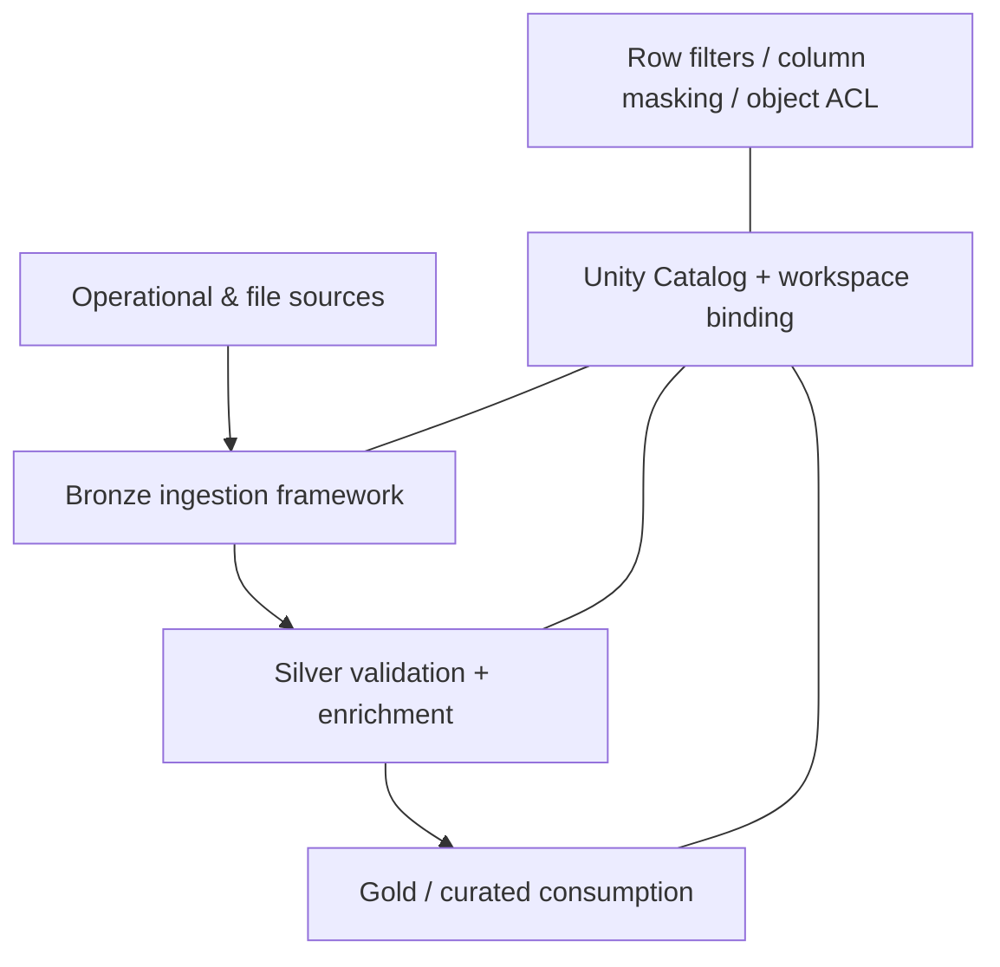
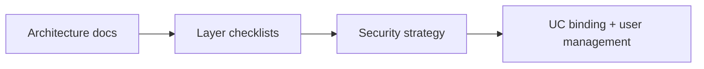

# Architecture

## Context diagram

## Implementation flow

## Design notes

- Prefer layered medallion / governed platform patterns where applicable.
- Keep configuration and secrets outside Git.
- Preserve auditability: documentation must match repository evidence.
